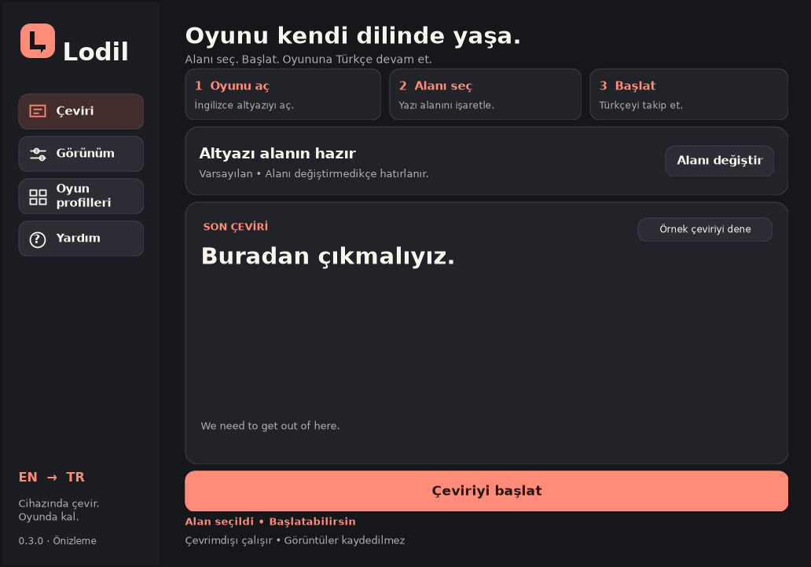

# Lodil

**Oyunu kendi dilinde yaşa.**

İngilizce oyun altyazılarını cihazında okuyup Türkçeye çeviren, ücretsiz ve açık kaynak bir uygulama. Windows ve Android / Android TV sürümleri tek depoda geliştirilir.

[İndirilenler ve sürümler](https://github.com/bladeagent37-commits/Ludil/releases) · [Kurulum](docs/KURULUM.md) · [Testler](docs/TESTLER.md) · [Katkı rehberi](CONTRIBUTING.md) · [MIT lisansı](LICENSE)


## İndir

| Platform | Dosya | Kullanım |
| --- | --- | --- |
| Windows 10/11, x64 | `Lodil-0.3.0-Windows-x64.zip` | ZIP’in tamamını çıkart, `Lodil.exe` dosyasını aç. .NET ve çeviri modelleri pakettedir. |
| Android 8+ / Android TV | `Lodil-0.3.0-Android.apk` | APK’yı cihaza kur. Çeviri ve İngilizce OCR modelleri pakettedir. |
| Doğrulama | `SHA256SUMS.txt` | İndirdiğin dosyanın SHA-256 özetini karşılaştır. |

**0.3.0 ilk herkese açık önizleme sürümüdür.** Yerel derleme ve otomatik test sonuçları [test belgesinde](docs/TESTLER.md) açıklanır. Gerçek Windows oyun yakalaması ve TCL/PlayStation HDMI kullanımı henüz doğrulanmadı.

## Neler yapar?

- Windows’ta seçtiğin İngilizce altyazı alanını okur, Türkçesini oyunun üzerine yerleştirir.
- Oyunlara göre alan, yazı boyutu, renk ve okuma hızı kaydeder.
- Android’de sistem izniyle paylaşılan ekranı okur veya Windows’tan yerel ağ üzerinden Türkçe altyazı alır.
- Windows’taki **Yardım → TV’ye bağlan** seçeneğiyle Android TV’deki adres ve kodu kullanarak eşleşir. Ek Python kurulumu gerekmez.
- Türkçe arayüz, kömür grisi tema, mercan vurgu, klavye/dokunmatik/kumanda desteği sunar.
- Çeviri motoru çevrimdışı çalışır; hesap, reklam, abonelik veya ücretli API gerekmez.

## Hızlı başlangıç

**Windows:** Oyunu pencere veya kenarlıksız tam ekran modunda aç, İngilizce altyazısını etkinleştir. Lodil’de **Alanı seç → Çeviriyi başlat** adımlarını izle. `Ctrl+Shift+F8` başlatır/durdurur; `F9` aynı tuşlarla yazıyı gizler/gösterir, `F10` alan seçimini açar.

**Android:** Önce **Örnek görüntüde oku ve Türkçeye çevir** aracını dene. **Çeviriyi başlat** üzerinden kaynağı seç ve Android’in istediği izinleri ver. TV’ye Windows’tan göndermek için Android’de **Bağlantı → Bilgisayardan altyazı almaya başla**, Windows’ta **Yardım → TV’ye bağlan** yolunu kullan.

**HDMI:** APK bir Remote Play istemcisi değildir. HDMI girişindeki görüntünün okunabilmesi ve üstüne yazı yerleştirilebilmesi cihazın izinlerine bağlıdır. **HDMI yazı testi** yalnızca katmanın görünürlüğünü sınar; görüntü yakalama veya PlayStation bağlantısı kanıtı değildir. [Ayrıntılar](docs/KURULUM.md).



*Üretim arayüz kaynaklarından Linux üzerinde üretilen, örnek metin kullanan önizleme. Gerçek oyun testi değildir.*

## Gizlilik

Ekran görüntüleri ve çeviri geçmişi diske yazılmaz. Varsayılan çeviri cihazda yapılır. TV bağlantısında yalnızca İngilizce/Türkçe altyazı metni eşleştirilen ev ağı cihazına gönderilir; eşleştirme anahtarı bellekte tutulur. [Gizlilik açıklaması](docs/GIZLILIK.md).

## Kaynaktan derle

Gereksinimler: JDK 17, Android SDK 35 / Build Tools 35.0.0, .NET SDK 10.0.403 ve model indirme için Python 3.10+.

```sh
python3 scripts/fetch-assets.py
./gradlew :app:assembleRelease :app:lintRelease
dotnet run --project desktop/Lodil.Smoke -- app/src/main/assets/translation
```

Windows paketi için PowerShell’de `desktop/publish-windows.ps1` çalıştır. Android yayın imzası ortam değişkenlerinden alınır; anahtarlar depoya konmaz. Ayrıntılar [geliştirme belgesinde](docs/GELISTIRME.md).

GitHub Actions kullanılmaz. Derleme, doğrulama ve paketleme yerelde yapılır.

## Lisans

Lodil kodu **MIT** lisanslıdır. OCR, ONNX Runtime, .NET ve çeviri modellerinin kendi lisansları korunur: [üçüncü taraf bildirimleri](LICENSES.md).

---

**English:** Lodil is a free, offline English-to-Turkish game subtitle translator for Windows and Android / Android TV. It combines OCR, on-device translation, caption overlays and optional paired LAN delivery to a TV. This is a public preview; real-device limitations and local verification results are documented above.
